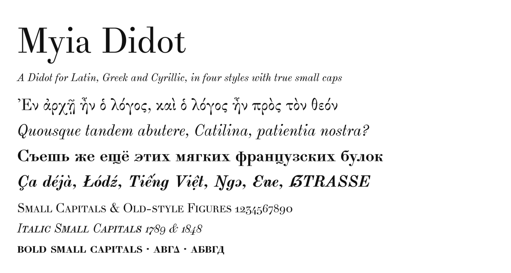

# Myia Didot

Myia Didot is a Didot typeface for Latin, Greek and Cyrillic text, with
four styles: Regular, Italic, Bold and Bold Italic. Each style has true
small capitals. It extends Alexey Kryukov's
[Theano Didot](https://github.com/akryukov/theano), whose Regular it
continues. The italics are adapted from his Old Standard Italic.

It is free software under the [SIL Open Font License](OFL.txt): you may
use it for any purpose, embed it in documents and web pages, and modify
and redistribute it under the same license.

> **Status:** in development, version 0.900. Every glyph in all four
> styles has been drawn and reviewed, and the fonts are complete for the
> scripts below. Spacing, hinting and details of the derived styles are
> still being refined before a first release.

## Download and installation

Releases will be published on the
[GitHub releases page](https://github.com/ghschaden/MyiaDidot/releases).
Each archive contains the fonts in three formats:

- `otf/`: OpenType (CFF) fonts. Use these for desktop publishing and
  LaTeX (LuaLaTeX and XeLaTeX via `fontspec`).
- `ttf/`: TrueType fonts. These are hinted for screens and are the better
  choice on Windows.
- `woff2/`: web fonts, for use with `@font-face`.

To install the fonts:

- **Windows:** right-click the `.otf` or `.ttf` files and choose *Install*.
- **macOS:** double-click a file and click *Install Font* in Font Book.
- **Linux:** copy the files to `~/.local/share/fonts/`, then run
  `fc-cache -f`.

Install only one format, OTF or TTF. If both are installed, applications
may pick either one.

Until the first release, you can build the fonts from source; see
[CONTRIBUTING.md](CONTRIBUTING.md).

## Languages and scripts

- **Latin:** the alphabets of Western, Central and Eastern European
  languages and of Turkish and Azerbaijani, Vietnamese, and Pan-African
  orthographies, including their capital forms (Ɛ Ɔ Ŋ Ƴ …). The coverage
  follows Google Fonts' Latin Core, Plus, Vietnamese, African and Beyond
  sets.
- **Phonetics:** IPA, and the Americanist phonetic alphabet.
- **Greek:** monotonic and full polytonic Greek, including archaic letters
  and numerals.
- **Cyrillic:** Russian, Ukrainian, Belarusian, Bulgarian, Serbian and
  Macedonian.

In all, there are about 1,560 characters in each style.

## OpenType features

The features work in applications that support them, such as LibreOffice,
Adobe InDesign, LuaLaTeX and XeLaTeX (`fontspec`), and web browsers
(`font-feature-settings`).
For LaTeX, see [Using Myia Didot with LuaLaTeX](docs/lualatex.md): loading
the fonts, languages with babel or polyglossia, and the fontspec name of
each feature.

| Feature | What it does |
|---|---|
| `smcp`, `c2sc` | Small capitals, made from lowercase and from capitals |
| `onum`, `lnum` | Old-style and lining figures (lining is the default) |
| `pnum`, `tnum` | Proportional and tabular figures |
| `sups`, `subs`, `sinf`, `numr`, `dnom`, `frac`, `ordn` | Superiors, inferiors, fractions and ordinals |
| `zero` | Slashed zero |
| `case`, `cpsp` | Case-sensitive punctuation and capital spacing for all-caps text |
| `liga`, `dlig` | Standard f-ligatures; discretionary ligatures (ct, st, sp, Qu, Th, th, tt) |
| `hist` | Long s (ſ) and its ligatures |
| `locl` | Localized forms. The language tag must be set in the application. |
| `ss01` | Romanian comma-below Ș ș Ț ț in place of the cedilla forms |
| `ss02` | SS in small caps for ß and ẞ |
| `ss11`, `calt` | Greek contextual forms (initial and medial theta) |
| `salt` | Stylistic alternates |

These localized forms are available:
- Bulgarian Cyrillic forms.
- Serbian and Macedonian forms (б г д п т ѓ).
- Romanian and Moldovan comma-below letters.
- Catalan ŀl.
- Dutch accented IJ.
- An IPA a, for text tagged `und-fonipa`.

## Known limitations

- **Generated styles:** the Bold and Bold Italic are derived from the
  Regular and Italic, then corrected by hand. A few details still differ
  from a fully hand-drawn bold. The open points are listed in
  [FONT-DESIGN.md](FONT-DESIGN.md).
- **Hinting:** hinting is automatic (ttfautohint and otfautohint). At very
  small screen sizes, a few round or hooked tops can sit a fraction of a
  pixel off the line.
- **Cyrillic:** only the basic set. Non-Slavic Cyrillic orthographies are
  not covered.
- **No variable font:** the four styles are separate static fonts.

## Credits

- Theano Didot: Alexey Kryukov (2007–2011), the base of the Regular.
- Old Standard Italic: Alexey Kryukov (2006–2008), the source of the
  italic letterforms.
- Mathematical Fraktur 𝔐 𝔓 𝔖 𝔭: the Libertinus Project Authors.
- Myia Didot: the Myia Didot Project Authors (2026).

The full history of changes is in [FONTLOG.txt](FONTLOG.txt).

## The name

Alexey Kryukov named his Theano Classical Fonts after Theano, the
ancient Greek philosopher who was first a student of Pythagoras and, by
tradition, became his wife (see his FONTLOG in `sources/upstream/`).
Myia (Μυῖα), according to the same tradition, was their daughter, a
Pythagorean herself: a letter on the care of a newborn child, addressed
to a woman named Phyllis, has come down under her name. A font derived from Theano Didot may not carry the name
"Theano", a Reserved Font Name under its license, so this one is named
after her daughter.

## License

SIL Open Font License 1.1, see [OFL.txt](OFL.txt). "Theano" is a Reserved
Font Name of the upstream fonts, which is why this derivative has its own
name (see above).

## Contributing

To build the fonts, run the tests or work on the sources, see
[CONTRIBUTING.md](CONTRIBUTING.md). Open design work is listed in
[FONT-DESIGN.md](FONT-DESIGN.md), and open tooling work in
[DEVELOPMENT.md](DEVELOPMENT.md).
